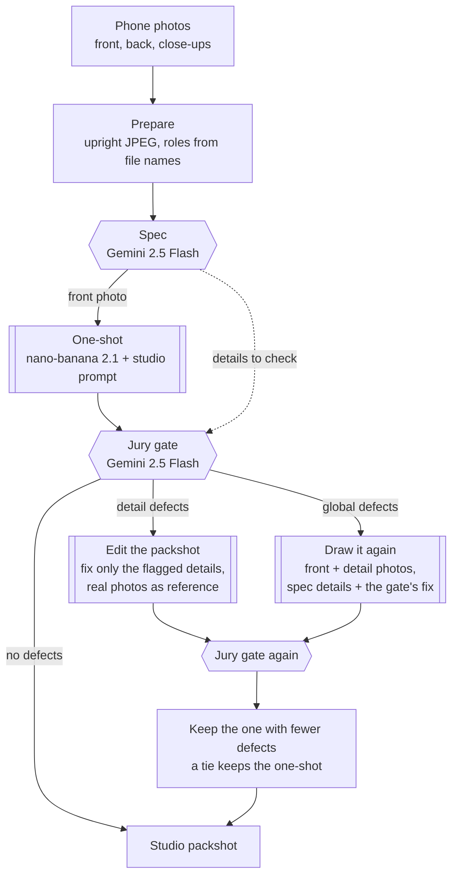
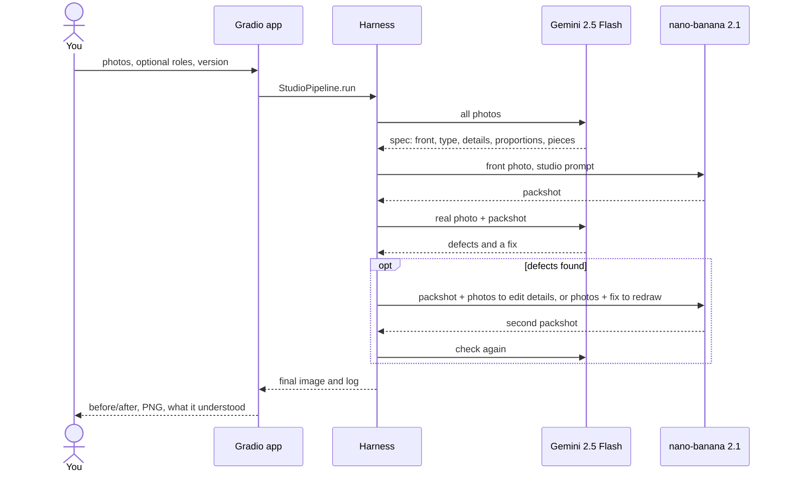

# Zir Image Enhancer

Turn a few phone photos of a garment into one clean studio packshot: front view, laid flat, on a light background, with the real colours and details kept.

Built by team `D3A24` for the [Sartiq](https://www.sartiq.ai/) challenge at the [Neural Wave 2026 Hackathon](https://neuralwave.ch).

## What it does

You upload the photos you have (on a hanger, on a mannequin, worn, or laid on the floor). The app returns a catalogue-style image of the same garment, without the person, mannequin or hanger, and tells you what it understood and what it checked.

Two hosted models do the work, both through [fal.ai](https://fal.ai):

| Model | Role |
|---|---|
| Gemini 2.5 Flash (vision) | Reads the photos before generating (the "spec") and checks the result afterwards (the "gate") |
| nano-banana 2.1 edit (image) | Draws the packshot from the photos and a written instruction |

Our code around them (the harness) decides which photos are sent, writes the instruction, checks the result on what the jury looks at and repairs it once if needed.

## How it works

The default version (v3) keeps the prompt that scores best on the leaderboard and only steps in when the check finds a defect the jury would see: crop, logos, text, zips and buttons, seams, texture or colour.



The same run, as calls between the parts:



What the gate checks: same garment, front view, nothing cropped, logos and text, zips and buttons, seams, texture, colour, proportions, studio light, no person or props, no missing piece of a set, every listed detail, and no invented text or logos.

### Versions

All three are in the code; pick one in the app or with `--mode` in `zir-run` and `scripts/reconstruct.py`.

| Version | `--mode` | What it does | Holdout (38) | Dev leaderboard |
|---|---|---|---|---|
| v1 | `oneshot` | Studio prompt and the front photo, one generation | 61.82 | 68.62 |
| v2 | `harness` | Spec details and sets in the prompt, named detail photos, gate, one repair | 61.77 (24 of 38) | 68.30 (with the removed flattening line) |
| **v3 (default)** | `jury` | v1 first; when the jury gate finds a defect, details are fixed by editing the packshot and global problems (colour, proportions, view, crop) by drawing it again | **61.90** | |

v3 also picks the photo style per garment (`--studio-style auto`, the default): garments photographed on a mannequin get the invisible-mannequin look most Sartiq targets have, the others the flat studio prompt. On the 10 holdout garments shot on a mannequin that scored +1.3 (7 of 10 wins); on hanger and flat photos it lost, so it is not used there. With it v3 scores **62.20** on the holdout. Dev is 67% mannequin photos (18 of 27) against 26% in our holdout, while the test set is all hanger photos.

On the holdout v3 repaired 5 of 38 garments (buttons, an embroidered logo, two textures, a colour), for about $0.01 per garment on top of v1. Editing the packshot keeps its shape and framing (t0087 +0.8, t0327 +0.9) but cannot fix a colour (t0314: -4.1 editing, +10.4 redrawing), hence the split.

One garment takes 20 to 60 seconds and about $0.05 to $0.13.

## Requirements

- [uv](https://docs.astral.sh/uv/) (it installs Python 3.11+ for you)
- A fal.ai API key with balance
- No GPU: both models run on fal

## Run it

1. Copy `.env.example` to `.env` and set `FAL_KEY`.
2. Start the app from the repo root:

   ```bash
   uv run zir-app
   ```

3. Open `http://localhost:7860`, upload the front photo first, then the back and close-ups, and press **Create studio shot**.

Tips:

- Detail photos are only used when they have a role. Type one role per photo in the app (`front`, `back`, `detail chest logo`) or put it in the file name (`03_detail_chest-logo.jpg`).
- Add `GRADIO_SHARE=1` before the command to get an https link a phone can open (needed for the camera).
- Every run keeps its photos and attempts in `local/app_runs/<name>/`.
- Spending stops at `ZIR_FAL_BUDGET_USD` in `.env`, counted in `local/fal_ledger.jsonl`.

### Many garments at once

Put one folder of photos per garment in `local/captures/`, then:

```bash
uv run python scripts/make_capture_manifest.py --photos local/captures
```

```bash
uv run zir-run --manifest local/captures/inputs.jsonl --out local/submissions --team d3a24
```

It writes the official submission layout (`<out>/<team>/<garment>/front.png`).

## Project layout

| Path | What it is |
|---|---|
| `src/zir_image_enhancer/app.py` | The Gradio app |
| `src/zir_image_enhancer/cli.py` | `zir-run`, the batch runner |
| `src/zir_image_enhancer/pipeline.py` | `StudioPipeline`, shared by the app and `zir-run` |
| `src/zir_image_enhancer/reconstruction/` | Spec, prompt, references, gate and the repair loop |
| `src/zir_image_enhancer/generation/` | fal client with cache and budget guard, model and studio prompt |
| `scripts/` | Holdout evaluation (`reconstruct.py`, `score_run.py`, `compare_sheet.py`, `gallery.py`) and the official starter scripts |
| `docs/PROMPTS.md` | Every prompt we tried and how it scored |
| `experiments/results.csv` | Every scored run |
| `tools/`, `docs/neural-wave-2026/` | Official scorer, baselines and challenge docs (vendored) |

## Evaluation

Scores come from the official scorer on a holdout of 38 training pairs grouped by target. The scorer needs the real studio photo, so it is only used offline, never in the app.

| Version | Holdout score |
|---|---|
| Phone photo unchanged | 39.78 |
| Official baseline (nano-banana 2.1, first photo) | 60.22 |
| v1, one-shot studio prompt | 61.82 |
| v2, harness with spec, gate and repair (24 of 38 garments) | 61.77 (one-shot on the same 24: 62.34) |
| Harness + flattening (all 38, removed) | 60.72 |
| v3, one-shot + jury gate, redraw only | 61.76 |
| v3, one-shot + jury gate, edit details and redraw global problems | 61.90 |
| v3 + invisible-mannequin style for mannequin photos (`auto`) | 62.20 |

The final ranking adds a human review of crop, logos, text, zips, seams, texture and colour to the leaderboard score. v3 keeps v1's score and repairs the garments where those fail. Picking the best version per garment (one-shot, harness and the removed variants) would reach 63.6 if we knew the target, but without it neither a scorer run against the input photo (61.0 to 62.1 depending on the metric) nor a Gemini judge on the jury's criteria (61.3) beat the one-shot prompt: neither did picking the candidate most similar to the others (consensus, 61.0 to 61.6). Per-garment differences are mostly sampling luck. LPIPS, SSIM and CLIP (45% of the score) are measured on the canonical crop with its own background, so the background tone counts; replacing ours (RGB ~228) with 240 to 255 did not help (61.4 to 61.7). Upscaling the input photos x2 with Real-ESRGAN before generation lowered the score by 3.0 on the small holdout (colour and silhouette both dropped). Simple post-processing does not help either: stretching the output 4% or 8% taller (-0.3, -0.8), blurring (0.0) or sharpening (-0.2). On dev, seven submissions with different prompts and versions all landed between 68.30 and 68.75, so prompt wording moves the dev score by about 0.1. A per-garment colour correction cannot be learned either: on 103 garments, predicting the needed Lab shift from our output, the phone photo and its background (leave-one-out) was no better than not correcting (L* error 5.08 vs 5.10), and the only steady bias, outputs about 1.7 b* yellower, moves the score by under 0.1. Everything we tried and dropped is in `docs/PROMPTS.md` and `experiments/results.csv`; removed code is kept in the tags `exp-snapshot-2026-10-17` and `pre-cleanup-2026-10-17`.

Everything you need to evaluate is in the repo except the dataset, which goes in `data/sartiq_neural_wave_2026` (never committed). The `Makefile` wraps the official tools:

```bash
make holdout predict predict-identity   # holdout split, our pipeline, and the floor
```

```bash
make eval && make eval TEAM=identity    # score both with the frozen scorer
```

| Target | What it does |
|---|---|
| `make holdout` | Carves the self-evaluation holdout out of the training pairs |
| `make predict` | Runs our pipeline over the holdout into `predictions/<TEAM>/` |
| `make eval` | Scores `predictions/<TEAM>/` with the official scorer |
| `make run` / `make validate` | Runs our pipeline over dev into `submissions/<TEAM>/` and checks it |
| `make baseline-nanobanana` | The official hosted baseline over dev (add `-dry` first; costs about $2) |
| `make predict-nanobanana` | The hosted baseline on the holdout, to compare like for like |

Override defaults on the command line, for example `make eval TEAM=zir JOBS=4 LIMIT=8`. `make holdout` now holds out 5% of the pairs (`FRAC=0.05`, about $1.1 per pipeline run); `scripts/reconstruct.py` defaults to `--split holdout-small`, a fixed half of our 38-pair holdout, so older scores stay comparable. Our own experiment scripts (`reconstruct.py`, `score_run.py`, `compare_sheet.py`, `gallery.py`) use the starter repo clone in `local/neural-wave-2026` instead.

## Development

```bash
uv run --extra dev ruff check .
```

```bash
uv run --extra dev mypy src scripts
```

```bash
uv run --extra dev pytest
```

A VS Code Dev Container (`.devcontainer/`) is included; on Vast.ai, build the same image with `docker build -f .devcontainer/Dockerfile .` and expose port 7860.

## Credits

The self-evaluation harness is vendored unmodified from the official starter repo [`shootify-io/neural-wave-2026`](https://github.com/shootify-io/neural-wave-2026) at commit `ce3d736` (16 October 2026), under the Neural Wave 2026 hackathon terms:

| Path | Upstream | Notes |
|---|---|---|
| `tools/scorer/` | `scorer/` | The frozen scorer (`sartiq-score`), installed through `[tool.uv.sources]` |
| `tools/baselines/` | `baselines/` | Identity floor and hosted baseline |
| `scripts/eval_val.py`, `make_holdout.py`, `make_submission.py` | `scripts/` | Unchanged; the `Makefile` supplies this repo's dataset path |
| `docs/neural-wave-2026/` | `docs/` | Challenge docs and the problem statement |

Dataset images are provided under the hackathon terms and are not redistributed in this repository.
