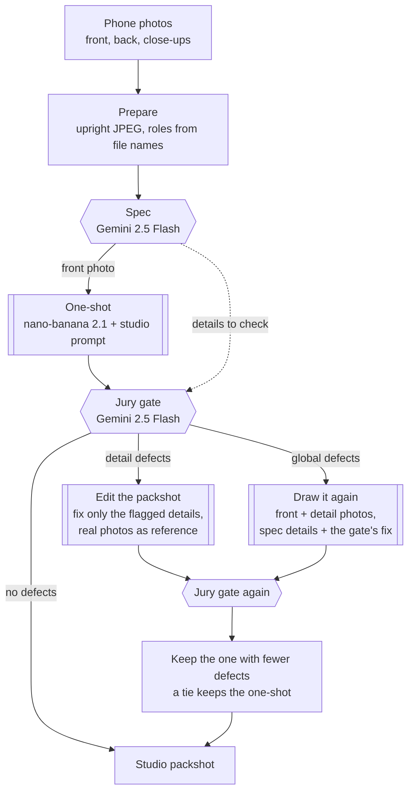

# Zir Image Enhancer

Turn a few phone photos of a garment into one clean studio packshot: front view, laid flat, on a light background, with the real colours and details kept.

Built by team `D3A24` for the [Sartiq](https://www.sartiq.ai/) challenge at the [Neural Wave 2026 Hackathon](https://neuralwave.ch).

## What it does

You upload the photos you have (on a hanger, on a mannequin, worn, or laid on the floor). The app returns a catalogue-style image of the same garment, without the person, mannequin or hanger, and tells you what it understood and what it checked.

Two hosted models do the work, both through [fal.ai](https://fal.ai):

| Model | Role |
|---|---|
| Gemini 2.5 Flash (vision) | Reads the photos before generating (the "spec") and checks the result afterwards (the "gate") |
| nano-banana 2.1 edit (image) | Draws the packshot from the photos and a written instruction |

Our code around them (the harness) decides which photos are sent, writes the instruction, checks the result on what the jury looks at and repairs it once if needed.

## How it works

One garment through the pipeline (v3): it keeps the prompt that scores best on the leaderboard and only steps in when the check finds a defect the jury would see (crop, logos, text, zips and buttons, seams, texture or colour).



The same run, as calls between the parts:


What the gate checks: same garment, front view, nothing cropped, logos and text, zips and buttons, seams, texture, colour, proportions, studio light, no person or props, no missing piece of a set, every listed detail, and no invented text or logos.

### How we got here

This repo runs v3. The other versions are kept in the tag `pre-v3-only-2026-10-18`.

| Version | What it does | Holdout (38) | Dev leaderboard |
|---|---|---|---|
| v1 | Studio prompt and the front photo, one generation | 61.82 | 68.62 |
| v2 | Spec details and sets in the prompt, named detail photos, gate, one redraw | 61.77 (24 garments) | 68.30 |
| **v3** | v1, then the jury gate; a detail defect is fixed by editing the packshot, a global one (colour, proportions, view, crop) by drawing it again | **61.90** | **68.75** |
| v4 | 9 versions per garment, one pick by CLIP and AlexNet embeddings, the jury gate on the top 3 | 63.01 | 69.59 |

v4 scored best, but it makes nine images per garment: about nine times the cost and three times the time. We kept v3: one image per garment, repaired only when the jury would see a defect.

Cost and time per garment: about $0.06 and 20 seconds with nano-banana 2.1, plus a repair for about one garment in ten. With nano-banana Pro (`--model nano-banana-pro`) about $0.16. The spec and each gate check add about $0.002.

## Requirements

- [uv](https://docs.astral.sh/uv/) (it installs Python 3.11+ for you)
- A fal.ai API key with balance
- No GPU: both models run on fal

## Run it

1. Copy `.env.example` to `.env` and set `FAL_KEY`.
2. Start the app from the repo root:

   ```bash
   uv run zir-app
   ```

3. Open `http://localhost:7860`, upload one to five photos of the same garment (the front first, then the back and close-ups) and press **Create studio shot**.

Tips:

- Detail photos are only used when they have a role. Type one role per photo in the app (`front`, `back`, `detail chest logo`) or put it in the file name (`03_detail_chest-logo.jpg`).
- Add `GRADIO_SHARE=1` before the command to get an https link a phone can open (needed for the camera).
- Every run keeps its photos and attempts in `local/app_runs/<name>/`.
- Spending stops at `ZIR_FAL_BUDGET_USD` in `.env`, counted in `local/fal_ledger.jsonl`.

### A whole split (the submission)

`zir-run` runs the same pipeline over a manifest and writes the submission layout, `submissions/<team>/<garment_id>/front.png`. Check what it will do first, then run it:

```bash
uv run zir-run --manifest data/sartiq_neural_wave_2026/test/inputs.jsonl --out submissions --team d3a24 --dry-run
```

```bash
uv run zir-run --manifest data/sartiq_neural_wave_2026/test/inputs.jsonl --out submissions --team d3a24
```

Add `--model nano-banana-pro` to use the larger model. Every paid call is cached, so a rerun is free. Then check the folder with the official validator, which also writes `d3a24.zip`:

```bash
uv run --extra scorer python scripts/make_submission.py --submissions submissions --team d3a24 --dataset data/sartiq_neural_wave_2026 --zip
```

For your own photos, use the app, or give `zir-run` a manifest with one row per garment: `{"garment_id": "c01", "inputs": ["C:/photos/c01/1.jpg", "C:/photos/c01/2.jpg"]}`.

## Project layout

| Path | What it is |
|---|---|
| `src/zir_image_enhancer/app.py` | The Gradio app |
| `src/zir_image_enhancer/cli.py` | `zir-run`, the batch runner |
| `src/zir_image_enhancer/pipeline.py` | `StudioPipeline`, shared by the app and `zir-run`: prepares the photos, runs the reconstructor |
| `src/zir_image_enhancer/reconstruction/` | Spec, gate, repair prompts, reference photos and the v3 loop (`reconstructor.py`) |
| `src/zir_image_enhancer/generation/` | fal client with cache and budget guard, the models and the studio prompts |
| `scripts/eval_val.py`, `make_holdout.py`, `make_submission.py` | Official starter scripts (vendored): holdout, scoring, validation and ZIP |
| `docs/PROMPTS.md` | Every prompt we tried and how it scored |
| `experiments/results.csv` | Every scored run |
| `tools/`, `docs/neural-wave-2026/` | Official scorer, baselines and challenge docs (vendored) |

## Evaluation

Scores come from the official scorer (colour 40%, LPIPS 25%, CLIP 15%, silhouette 15%, SSIM 5%) on a holdout of 38 training pairs grouped by target, and a fixed half of it (19 pairs) for cheaper runs. The scorer needs the real studio photo, so it runs offline only. Dev scores come from the leaderboard.

| Version | Holdout score |
|---|---|
| Phone photo unchanged | 39.78 |
| Official baseline (nano-banana 2.1, first photo) | 60.22 |
| v1, one-shot studio prompt | 61.82 |
| v3, one-shot + jury gate + edit or redraw | 61.90 |
| v4, 9 versions + selector (in the tag) | 63.01 |

What we tried and dropped (all rows in `experiments/results.csv`, every prompt in `docs/PROMPTS.md`, removed code in the tags `exp-snapshot-2026-10-17`, `pre-cleanup-2026-10-17` and `pre-v3-only-2026-10-18`):

| Idea | Result |
|---|---|
| Other generators: nano-banana Pro, FLUX.2, Seedream 4.5, Qwen-Image-Edit 2511 | 61.2, 43.4, 49.6, 54.4 |
| nano-banana Pro versions added to the v4 pool on dev (with and without v3 in Pro) | 69.34 and 68.89 against 69.59 |
| Pre-processing: cut-out, crop, denoise, 2x super-resolution (Real-ESRGAN) | -3.9, -1.3, -1.9, -3.0 |
| Post-processing: colour offsets, a learned colour model, saturation, shading, background tone, stretch, blur, sharpen | -0.1 to -14 |
| A per-garment colour correction predicted from the photo and its background | no better than none (L* error 5.08 vs 5.10) |
| Prompt lines: spec-written prompt, flatten, real length with vivid colour, relight pass | -3.0, -1.2, -1.3, -1.5 |
| Invisible-mannequin style for mannequin photos | +1.3 on those garments, but every reference is flat-lay |
| Picking between versions with a Gemini judge, a scorer run against the input photo, or consensus | at or below a random pick on the holdout |
| A third embedding expert (DINOv2); embeddings before the generator (routing, conditional style) | no gain over CLIP + AlexNet |
| Prompt variants on dev (official prompt, change as little as possible, white background) | 68.59 to 68.66 against 68.62 |

Dev (67% mannequin photos) and test (all hanger photos) are distributed differently from our holdout (26% mannequin), which is why some holdout gains did not move dev.

Everything you need to evaluate is in the repo except the dataset, which goes in `data/sartiq_neural_wave_2026` (never committed). The `Makefile` wraps the official tools:

```bash
make holdout predict predict-identity   # holdout split, our pipeline, and the floor
```

```bash
make eval && make eval TEAM=identity    # score both with the frozen scorer
```

| Target | What it does |
|---|---|
| `make holdout` | Carves the self-evaluation holdout (5% of the pairs) out of the training pairs |
| `make predict` | Runs our pipeline (v3) over the holdout into `predictions/<TEAM>/` |
| `make eval` | Scores `predictions/<TEAM>/` with the official scorer |
| `make run` / `make validate` | Runs our pipeline over dev (`SPLIT=test` for test) into `submissions/<TEAM>/` and checks it (`ZIP=1` also zips it) |
| `make baseline-nanobanana` | The official hosted baseline over dev (add `-dry` first; costs about $2) |
| `make predict-nanobanana` | The hosted baseline on the holdout, to compare like for like |

Override defaults on the command line, for example `make eval TEAM=zir JOBS=4 LIMIT=8` or `make run MODEL=nano-banana-pro`. The holdout scores above come from a 38-pair holdout and our own experiment scripts, kept in the tags; `make holdout` carves a 5% holdout, so its scores compare with each other but not with that table.

## Development

```bash
uv run --extra dev ruff check .
```

```bash
uv run --extra dev mypy src
```

```bash
uv run --extra dev pytest
```

A VS Code Dev Container (`.devcontainer/`) is included; on Vast.ai, build the same image with `docker build -f .devcontainer/Dockerfile .` and expose port 7860.

## Credits

The self-evaluation harness is vendored unmodified from the official starter repo [`shootify-io/neural-wave-2026`](https://github.com/shootify-io/neural-wave-2026) at commit `ce3d736` (16 October 2026), under the Neural Wave 2026 hackathon terms:

| Path | Upstream | Notes |
|---|---|---|
| `tools/scorer/` | `scorer/` | The frozen scorer (`sartiq-score`), installed through `[tool.uv.sources]` |
| `tools/baselines/` | `baselines/` | Identity floor and hosted baseline |
| `scripts/eval_val.py`, `make_holdout.py`, `make_submission.py` | `scripts/` | Unchanged; the `Makefile` supplies this repo's dataset path |
| `docs/neural-wave-2026/` | `docs/` | Challenge docs and the problem statement |

Dataset images are provided under the hackathon terms and are not redistributed in this repository.
