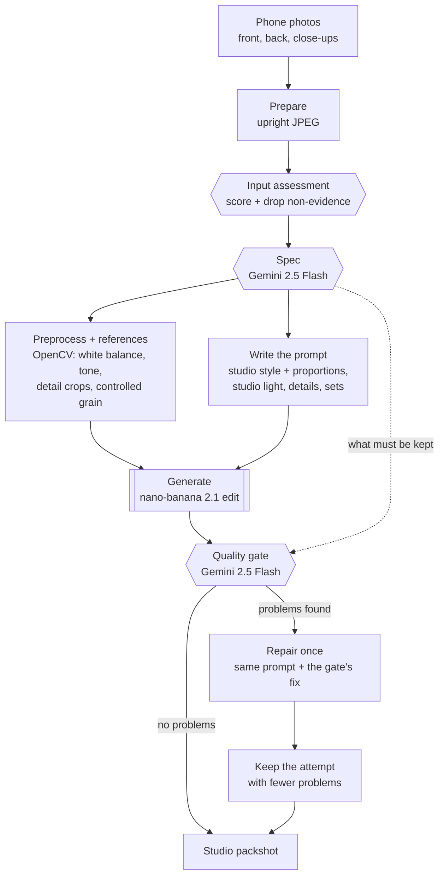
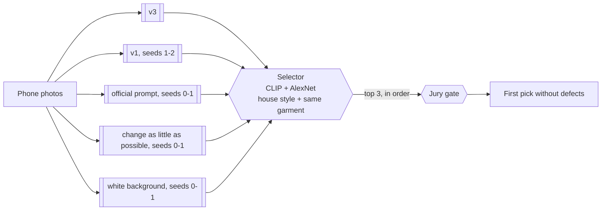

# Zir Image Enhancer

Zir (ukr. зір - vision, sight): Turn a few phone photos of a garment into one clean studio shot.

Built by team `D3A24` for the [Sartiq](https://www.sartiq.ai/) challenge at the [Neural Wave 2026 Hackathon](https://neuralwave.ch).

## What it does

You upload the photos you have (on a hanger, on a mannequin, worn, or laid on the floor). The app returns a catalogue-style image of the same garment, without the person, mannequin or hanger, and tells you what it understood and what it checked.

Two hosted models do the work, both through [fal.ai](https://fal.ai):

| Model | Role |
|---|---|
| Gemini 2.5 Flash (vision) | Reads the photos before generating (the "spec") and checks the result afterwards (the "gate") |
| nano-banana 2.1 edit (image) | Draws the packshot from the photos and a written instruction |

Our code around them (the harness) decides which photos are sent, writes the instruction, checks the result on what the jury looks at and repairs it once if needed. For the submission (v4) it also generates several versions of each garment and picks one with two small embedding models.

## How it works

One garment through v3, the app's default: it keeps the prompt that scores best on the leaderboard and only steps in when the check finds a defect the jury would see (crop, logos, text, zips and buttons, seams, texture or colour).



The same run, as calls between the parts:

```mermaid
sequenceDiagram
    actor U as You
    participant App as Gradio app
    participant H as Harness
    participant V as Gemini 2.5 Flash
    participant G as nano-banana 2.1
    U->>App: photos
    App->>H: StudioPipeline.run
    H->>V: all photos (assess)
    V-->>H: scores; non-evidence dropped
    H->>V: kept photos
    V-->>H: spec: front, type, details, proportions, photo setup, pieces
    H->>H: preprocess references (OpenCV: normalise, crop details)
    H->>G: front + pipeline-picked close-ups, prompt
    G-->>H: packshot
    H->>V: real photo + packshot
    V-->>H: defects and a fix
    opt defects found
        H->>G: packshot + photos to edit details, or photos + fix to redraw
        G-->>H: second packshot
        H->>V: check again
    end
    H-->>App: final image and log
    App-->>U: before/after, PNG, what it understood
```

What the gate checks: same garment, front view, nothing cropped, logos and text, zips and buttons, seams, texture, colour, proportions, studio light, no person or props, no missing piece of a set, every listed detail, and no invented text or logos.

### v4: several versions, one pick



nano-banana gives a different image every time, and on our holdout the best of 9 versions would score far higher than any single one (65.9 against 61.9). v4 picks without the target: two embedding models compare each candidate with the studio photos of the training set, CLIP (what the garment is, overall style) and AlexNet (the network LPIPS uses: texture and local structure). A candidate ranks high when it is close to that house style and to the garment's own photo. The jury gate then checks the top three in order, so a stylish but wrong image is never kept.

The gain grows with every distinct version in the pool, about +0.2 each from 2 to 9 versions on the holdout, while the best single version stays at 61.9.

### Versions

All four run in the app ("Pipeline version" selector). v1 to v3 also run in `zir-run` / `scripts/reconstruct.py` with `--mode`; v4 in batch is `scripts/run_v4.py`, the pipeline we submit.

| Version | What it does | Holdout (38) | Dev leaderboard |
|---|---|---|---|
| v1 `oneshot` | Studio prompt and the front photo, one generation | 61.82 | 68.62 |
| v2 `harness` | Spec details and sets in the prompt, named detail photos, gate, one repair | 61.77 (24 garments) | 68.30 |
| v3 `jury` (app default) | v1, then the jury gate; a detail defect is fixed by editing the packshot, a global one (colour, proportions, view, crop) by drawing it again | 61.90 | 68.75 |
| **v4** (app option, `scripts/run_v4.py`) | 9 versions per garment, one pick by two embedding experts, the jury gate on the top 3 | **63.01** | **69.59** |

Cost and time: about $0.06 and 20 to 60 seconds per version and garment (v1 to v3: one version, plus a repair for about one garment in ten; v4: nine, about $0.55 per garment). The spec and each gate check add about $0.002.

## Requirements

- [uv](https://docs.astral.sh/uv/) (it installs Python 3.11+ and the project environment for you; no conda or system Python setup needed)
- A fal.ai API key with balance
- No GPU: both models run on fal; the v4 selector runs on CPU

`uv run zir-app` sets up the app's dependencies on first use. To install everything at once —
the app, the official scorer and the dev tools — run `uv sync --all-extras` (or `make install`).

## Run it

1. Copy `.env.example` to `.env` and set `FAL_KEY`.
2. Start the app from the repo root (`--extra select` adds the local models v4 needs; `uv run zir-app` alone runs v1 to v3):

   ```bash
   uv run --extra select zir-app
   ```

3. Open `http://localhost:7860`, upload the front photo first, then the back and close-ups, pick the version and press **Create studio shot**.

Both versions take one to five photos of the same garment. v3 (the default) makes one image: about 20 seconds and $0.06. v4 makes nine and picks one: about a minute and $0.55, and the better pick on average.

Tips:

- You don't label photos. The pipeline assesses every photo, drops ones that carry no evidence (price tags, packaging, artifacts) and picks the front, the back and the detail close-ups itself.
- Add `GRADIO_SHARE=1` before the command to get an https link a phone can open (needed for the camera).
- Every run keeps its photos and attempts in `local/app_runs/<name>/`.
- v4 in the app ranks one garment at a time with the signal scales measured on the holdout, so it picks as the batch does (63.01 on the holdout either way).
- Spending stops at `ZIR_FAL_BUDGET_USD` in `.env`, counted in `local/fal_ledger.jsonl`.

### The submission (v4)

Print the plan and the cost first, then run it:

```bash
uv run --extra select python scripts/run_v4.py --split test --dry-run
```

```bash
uv run --extra select python scripts/run_v4.py --split test
```

It generates the 9 versions, picks one per garment, checks it with the gate and writes `local/submit/d3a24_test_v4.zip` with the submission limits checked. Every paid call is cached, so a rerun is free.

### Our own photos

Put one folder of photos per garment in `local/captures/`, then build the manifest and run v4 on it:

```bash
uv run python scripts/make_capture_manifest.py --photos local/captures
```

```bash
uv run --extra select python scripts/run_v4.py --name ours --manifest local/captures/inputs.jsonl
```

`uv run zir-run --manifest local/captures/inputs.jsonl --out local/submissions --team d3a24` runs v3 instead: one version, cheaper.

## Project layout

| Path | What it is |
|---|---|
| `src/zir_image_enhancer/app.py` | The Gradio app |
| `src/zir_image_enhancer/cli.py` | `zir-run`, the batch runner (v1 to v3) |
| `src/zir_image_enhancer/pipeline.py` | `StudioPipeline`, shared by the app and `zir-run` (v1 to v4) |
| `src/zir_image_enhancer/selection.py`, `embeddings.py` | v4: the nine versions, the ranking and the gate fallback, the CLIP and AlexNet experts |
| `src/zir_image_enhancer/reconstruction/` | Spec, prompts, references, gate and the repair loop |
| `src/zir_image_enhancer/generation/` | fal client with cache and budget guard, model and studio prompts |
| `scripts/run_v4.py`, `select_versions.py`, `make_zip.py` | v4 in batch: the versions, one pick per garment, the leaderboard ZIP |
| `scripts/reconstruct.py`, `score_run.py`, `compare_sheet.py`, `gallery.py` | Holdout runs, official scoring, side-by-side sheets |
| `scripts/eval_val.py`, `make_holdout.py`, `make_submission.py` | Official starter scripts (vendored) |
| `docs/PROMPTS.md` | Every prompt we tried and how it scored |
| `docs/PREPROCESSING.md` | The OpenCV preprocessing, its knobs and its evidence |
| `experiments/results.csv` | Every scored run |
| `tools/`, `docs/neural-wave-2026/` | Official scorer, baselines and challenge docs (vendored) |

## Evaluation

Scores come from the official scorer (colour 40%, LPIPS 25%, CLIP 15%, silhouette 15%, SSIM 5%) on a holdout of 38 training pairs grouped by target, and a fixed half of it (19 pairs) for cheaper runs. The scorer needs the real studio photo, so it runs offline only. Dev scores come from the leaderboard.

| Version | Holdout score |
|---|---|
| Phone photo unchanged | 39.78 |
| Official baseline (nano-banana 2.1, first photo) | 60.22 |
| v1, one-shot studio prompt | 61.82 |
| v3, one-shot + jury gate + edit or redraw | 61.90 |
| v4, 9 versions + selector | 63.01 |

What we tried and dropped (all rows in `experiments/results.csv`, every prompt in `docs/PROMPTS.md`, removed code in the tags `exp-snapshot-2026-10-17` and `pre-cleanup-2026-10-17`):

| Idea | Result |
|---|---|
| Other generators: nano-banana Pro, FLUX.2, Seedream 4.5, Qwen-Image-Edit 2511 | 61.2, 43.4, 49.6, 54.4 |
| nano-banana Pro versions added to the v4 pool on dev (with and without `pro_v3`) | 69.34 and 68.89 against 69.59 |
| Pre-processing: cut-out, crop, denoise, 2x super-resolution (Real-ESRGAN) | -3.9, -1.3, -1.9, -3.0 |
| Post-processing: colour offsets, a learned colour model, saturation, shading, background tone, stretch, blur, sharpen | -0.1 to -14 |
| A per-garment colour correction predicted from the photo and its background | no better than none (L* error 5.08 vs 5.10) |
| Prompt lines: spec-written prompt, flatten, real length with vivid colour, relight pass | -3.0, -1.2, -1.3, -1.5 |
| Invisible-mannequin style for mannequin photos | +1.3 on those garments, but every reference is flat-lay |
| Picking between versions with a Gemini judge, a scorer run against the input photo, or consensus | at or below a random pick on the holdout |
| A third embedding expert (DINOv2); embeddings before the generator (routing, conditional style) | no gain over CLIP + AlexNet |
| Prompt variants on dev (official prompt, change as little as possible, white background) | 68.59 to 68.66 against 68.62 |

Dev (67% mannequin photos) and test (all hanger photos) are distributed differently from our holdout (26% mannequin), which is why some holdout gains did not move dev.

Everything you need to evaluate is in the repo except the dataset, which goes in `data/sartiq_neural_wave_2026` (never committed). The `Makefile` wraps the official tools:

```bash
make holdout predict predict-identity   # holdout split, our pipeline, and the floor
```

```bash
make eval && make eval TEAM=identity    # score both with the frozen scorer
```

| Target | What it does |
|---|---|
| `make holdout` | Carves the self-evaluation holdout (5% of the pairs) out of the training pairs |
| `make predict` | Runs our pipeline (v3) over the holdout into `predictions/<TEAM>/` |
| `make eval` | Scores `predictions/<TEAM>/` with the official scorer |
| `make run` / `make validate` | Runs our pipeline over dev into `submissions/<TEAM>/` and checks it |
| `make baseline-nanobanana` | The official hosted baseline over dev (add `-dry` first; costs about $2) |
| `make predict-nanobanana` | The hosted baseline on the holdout, to compare like for like |

Override defaults on the command line, for example `make eval TEAM=zir JOBS=4 LIMIT=8`. Our experiment scripts (`reconstruct.py`, `score_run.py`, `compare_sheet.py`, `gallery.py`) use the starter repo clone in `local/neural-wave-2026` and its holdout; `reconstruct.py` defaults to `--split holdout-small`, a fixed half of that holdout.

## Development

Everything runs through uv: `uv sync --all-extras` (or `make install`) creates the
project's `.venv` with the dev tools and the scorer. The dev tools come from the default
`dev` group, so plain `uv run` already has them.

```bash
uv run ruff check .
```

```bash
uv run mypy src scripts
```

```bash
uv run pytest
```

Or `make fmt`, `make lint`, `make type`, `make test`, or `make check` for all of them.

A VS Code Dev Container (`.devcontainer/`) is included; on Vast.ai, build the same image with `docker build -f .devcontainer/Dockerfile .` and expose port 7860. It is uv-native (no conda) and installs the project environment into `/opt/venv`.

## Credits

The self-evaluation harness is vendored unmodified from the official starter repo [`shootify-io/neural-wave-2026`](https://github.com/shootify-io/neural-wave-2026) at commit `ce3d736` (16 October 2026), under the Neural Wave 2026 hackathon terms:

| Path | Upstream | Notes |
|---|---|---|
| `tools/scorer/` | `scorer/` | The frozen scorer (`sartiq-score`), installed through `[tool.uv.sources]` |
| `tools/baselines/` | `baselines/` | Identity floor and hosted baseline |
| `scripts/eval_val.py`, `make_holdout.py`, `make_submission.py` | `scripts/` | Unchanged; the `Makefile` supplies this repo's dataset path |
| `docs/neural-wave-2026/` | `docs/` | Challenge docs and the problem statement |

Dataset images are provided under the hackathon terms and are not redistributed in this repository.
