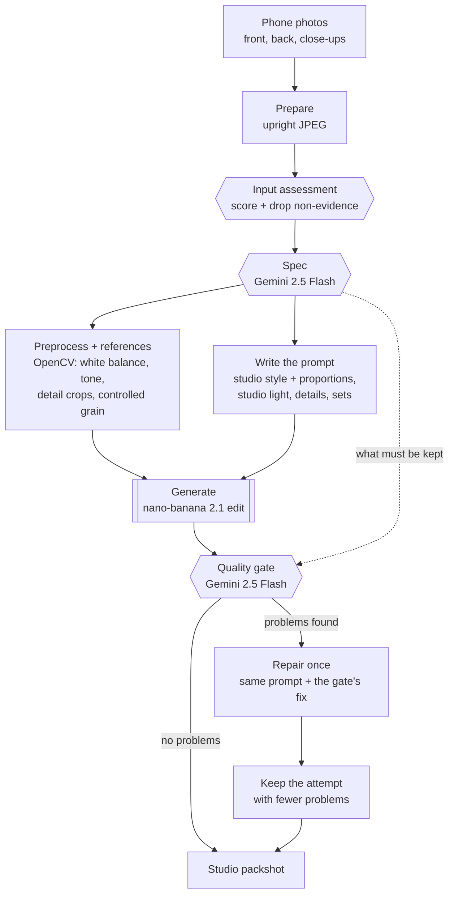

# Zir Image Enhancer

Zir (ukr. зір - vision, sight): Turn a few phone photos of a garment into one clean studio shot.

Built by team `D3A24` for the [Sartiq](https://www.sartiq.ai/) challenge at the [Neural Wave 2026 Hackathon](https://neuralwave.ch).

## What it does

You upload the photos you have (on a hanger, on a mannequin, worn, or laid on the floor). The app returns a catalogue-style image of the same garment, without the person, mannequin or hanger, and tells you what it understood and what it checked.

Two hosted models do the work, both through [fal.ai](https://fal.ai):

| Model | Role |
|---|---|
| Gemini 2.5 Flash (vision) | Reads the photos before generating (the "spec") and checks the result afterwards (the "gate") |
| nano-banana 2.1 edit (image) | Draws the packshot from the photos and a written instruction |

Our code around them (the harness) decides which photos are sent, writes the instruction from what the vision model saw, checks the result and repairs it once if needed.

## How it works



The same run, as calls between the parts:

```mermaid
sequenceDiagram
    actor U as You
    participant App as Gradio app
    participant H as Harness
    participant V as Gemini 2.5 Flash
    participant G as nano-banana 2.1
    U->>App: photos
    App->>H: StudioPipeline.run
    H->>V: all photos (assess)
    V-->>H: scores; non-evidence dropped
    H->>V: kept photos
    V-->>H: spec: front, type, details, proportions, photo setup, pieces
    H->>H: preprocess references (OpenCV: normalise, crop details)
    H->>G: front + pipeline-picked close-ups, prompt
    G-->>H: packshot
    H->>V: real photo + packshot
    V-->>H: problems and a fix
    opt problems found
        H->>G: same photos, prompt + fix
        G-->>H: second packshot
        H->>V: check again
    end
    H-->>App: final image and log
    App-->>U: before/after, PNG, what it understood
```

What the gate checks: same garment, front view, colour, proportions, studio light, no person or props, no missing piece of a set, every listed detail, and no invented text or logos.

Between the spec and generation, OpenCV prepares the references: it removes the phone photo's colour cast and lifts a dark or flat exposure, caps the resolution, crops the spec's detail boxes at full resolution so the model can copy logos and labels instead of redrawing them, and adds a small reproducible grain so the input stays a natural photograph. The vision steps read the originals untouched, and the gate still compares against the original front. See [`docs/PREPROCESSING.md`](docs/PREPROCESSING.md).

One garment takes 20 to 60 seconds and about $0.06 to $0.13.

## Requirements

- [uv](https://docs.astral.sh/uv/) (it installs Python 3.11+ and the project environment for you; no conda or system Python setup needed)
- A fal.ai API key with balance
- No GPU: both models run on fal

`uv run zir-app` sets up the app's dependencies on first use. To install everything at once —
the app, the official scorer and the dev tools — run `uv sync --all-extras` (or `make install`).

## Run it

1. Copy `.env.example` to `.env` and set `FAL_KEY`.
2. Start the app from the repo root:

   ```bash
   uv run zir-app
   ```

3. Open `http://localhost:7860`, upload the photos you have (the front, the back, close-ups), and press **Create studio shot**. The pipeline works out which photo is which.

Tips:

- You don't label photos. The pipeline assesses every photo, drops ones that carry no evidence (price tags, packaging, artifacts) and picks the front, the back and the detail close-ups itself.
- Add `GRADIO_SHARE=1` before the command to get an https link a phone can open (needed for the camera).
- Every run keeps its photos and attempts in `local/app_runs/<name>/`.
- Spending stops at `ZIR_FAL_BUDGET_USD` in `.env`, counted in `local/fal_ledger.jsonl`.

### Many garments at once

Put one folder of photos per garment in `local/captures/`, then:

```bash
uv run python scripts/make_capture_manifest.py --photos local/captures
```

```bash
uv run zir-run --manifest local/captures/inputs.jsonl --out local/submissions --team d3a24
```

It writes the official submission layout (`<out>/<team>/<garment>/front.png`).

## Project layout

| Path | What it is |
|---|---|
| `src/zir_image_enhancer/app.py` | The Gradio app |
| `src/zir_image_enhancer/cli.py` | `zir-run`, the batch runner |
| `src/zir_image_enhancer/pipeline.py` | `StudioPipeline`, shared by the app and `zir-run` |
| `src/zir_image_enhancer/reconstruction/` | Spec, prompt, references, gate and the repair loop |
| `src/zir_image_enhancer/reconstruction/preprocess.py` | OpenCV preprocessing of the generation references |
| `src/zir_image_enhancer/generation/` | fal client with cache and budget guard, model and studio prompt |
| `scripts/` | Holdout evaluation (`reconstruct.py`, `score_run.py`, `compare_sheet.py`, `gallery.py`, `preview_preprocess.py`, `compare_preprocess.py`) and the official starter scripts |
| `docs/PROMPTS.md` | Every prompt we tried and how it scored |
| `docs/PREPROCESSING.md` | The OpenCV preprocessing, its knobs and its evidence |
| `experiments/results.csv` | Every scored run |
| `tools/`, `docs/neural-wave-2026/` | Official scorer, baselines and challenge docs (vendored) |

## Evaluation

Scores come from the official scorer on a holdout of 38 training pairs grouped by target. The scorer needs the real studio photo, so it is only used offline, never in the app.

| Version | Holdout score |
|---|---|
| Phone photo unchanged | 39.78 |
| Official baseline (nano-banana 2.1, first photo) | 60.22 |
| One-shot studio prompt | 61.82 |
| Harness with spec, gate and repair (24 of 38 garments) | 61.77 (one-shot on the same 24: 62.34) |

The harness scores about the same as the one-shot prompt. We use it because it keeps details, shows every piece of a set and repairs invented text, which a jury sees and the metric barely does. Adding a flattening line for mannequin and worn photos scored 60.72 on all 38 and was removed. Everything we tried and dropped is in `docs/PROMPTS.md` and `experiments/results.csv`; removed code is kept in the tags `exp-snapshot-2026-10-17` and `pre-cleanup-2026-10-17`.

Everything you need to evaluate is in the repo except the dataset, which goes in `data/sartiq_neural_wave_2026` (never committed). The `Makefile` wraps the official tools:

```bash
make holdout predict predict-identity   # holdout split, our pipeline, and the floor
```

```bash
make eval && make eval TEAM=identity    # score both with the frozen scorer
```

| Target | What it does |
|---|---|
| `make holdout` | Carves the self-evaluation holdout out of the training pairs |
| `make predict` | Runs our pipeline over the holdout into `predictions/<TEAM>/` |
| `make eval` | Scores `predictions/<TEAM>/` with the official scorer |
| `make run` / `make validate` | Runs our pipeline over dev into `submissions/<TEAM>/` and checks it |
| `make baseline-nanobanana` | The official hosted baseline over dev (add `-dry` first; costs about $2) |
| `make predict-nanobanana` | The hosted baseline on the holdout, to compare like for like |

Override defaults on the command line, for example `make eval TEAM=zir LIMIT=8`. Keep `JOBS=1` unless you have plenty of RAM: each scorer worker loads torch and the scorer models (roughly 1.5 GB), so a memory-tight machine will otherwise crash workers mid-run and score those pairs 0. Our own experiment scripts (`reconstruct.py`, `score_run.py`, `compare_sheet.py`, `gallery.py`) are wrapped by `make reconstruct`, `make score`, `make sheet` and `make gallery`, and everything runs through the same uv environment as the app.

## Development

Everything runs through uv: `uv sync --all-extras` (or `make install`) creates the
project's `.venv` with the dev tools and the scorer. The dev tools come from the default
`dev` group, so plain `uv run` already has them.

```bash
uv run ruff check .
```

```bash
uv run mypy src scripts
```

```bash
uv run pytest
```

Or `make fmt`, `make lint`, `make type`, `make test`, or `make check` for all of them.

A VS Code Dev Container (`.devcontainer/`) is included; on Vast.ai, build the same image with `docker build -f .devcontainer/Dockerfile .` and expose port 7860. It is uv-native (no conda) and installs the project environment into `/opt/venv`.

## Credits

The self-evaluation harness is vendored unmodified from the official starter repo [`shootify-io/neural-wave-2026`](https://github.com/shootify-io/neural-wave-2026) at commit `ce3d736` (16 October 2026), under the Neural Wave 2026 hackathon terms:

| Path | Upstream | Notes |
|---|---|---|
| `tools/scorer/` | `scorer/` | The frozen scorer (`sartiq-score`), installed through `[tool.uv.sources]` |
| `tools/baselines/` | `baselines/` | Identity floor and hosted baseline |
| `scripts/eval_val.py`, `make_holdout.py`, `make_submission.py` | `scripts/` | Unchanged; the `Makefile` supplies this repo's dataset path |
| `docs/neural-wave-2026/` | `docs/` | Challenge docs and the problem statement |

Dataset images are provided under the hackathon terms and are not redistributed in this repository.
