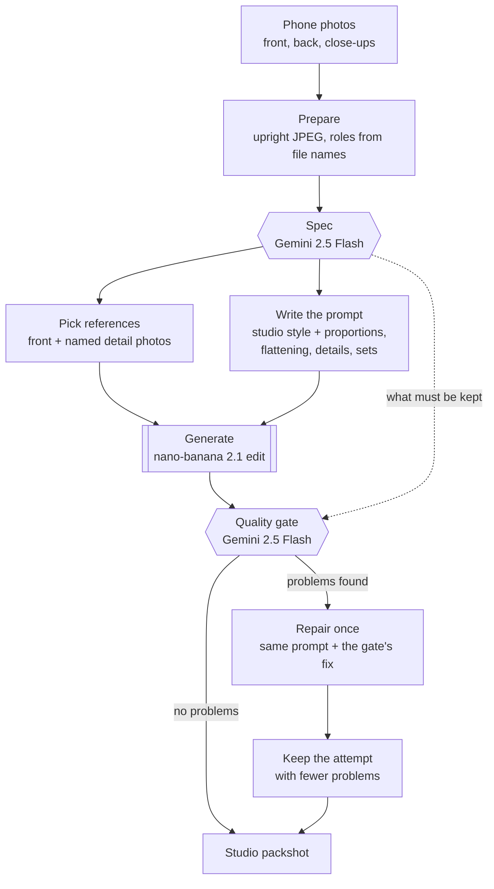
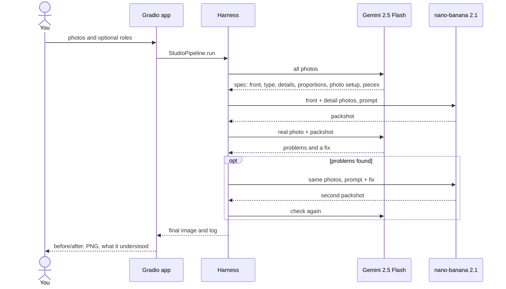

# Zir Image Enhancer

Turn a few phone photos of a garment into one clean studio packshot: front view, laid flat, on a light background, with the real colours and details kept.

Built by team `D3A24` for the [Sartiq](https://www.sartiq.ai/) challenge at the [Neural Wave 2026 Hackathon](https://neuralwave.ch).

## What it does

You upload the photos you have (on a hanger, on a mannequin, worn, or laid on the floor). The app returns a catalogue-style image of the same garment, without the person, mannequin or hanger, and tells you what it understood and what it checked.

Two hosted models do the work, both through [fal.ai](https://fal.ai):

| Model | Role |
|---|---|
| Gemini 2.5 Flash (vision) | Reads the photos before generating (the "spec") and checks the result afterwards (the "gate") |
| nano-banana 2.1 edit (image) | Draws the packshot from the photos and a written instruction |

Our code around them (the harness) decides which photos are sent, writes the instruction from what the vision model saw, checks the result and repairs it once if needed.

## How it works



The same run, as calls between the parts:



What the gate checks: same garment, front view, colour, proportions, studio light, no body or hanger shape left, no person or props, no missing piece of a set, every listed detail, and no invented text or logos.

One garment takes 20 to 60 seconds and about $0.06 to $0.13.

## Requirements

- [uv](https://docs.astral.sh/uv/) (it installs Python 3.11+ for you)
- A fal.ai API key with balance
- No GPU: both models run on fal

## Run it

1. Copy `.env.example` to `.env` and set `FAL_KEY`.
2. Start the app from the repo root:

   ```bash
   uv run zir-app
   ```

3. Open `http://localhost:7860`, upload the front photo first, then the back and close-ups, and press **Create studio shot**.

Tips:

- Detail photos are only used when they have a role. Type one role per photo in the app (`front`, `back`, `detail chest logo`) or put it in the file name (`03_detail_chest-logo.jpg`).
- Add `GRADIO_SHARE=1` before the command to get an https link a phone can open (needed for the camera).
- Every run keeps its photos and attempts in `local/app_runs/<name>/`.
- Spending stops at `ZIR_FAL_BUDGET_USD` in `.env`, counted in `local/fal_ledger.jsonl`.

### Many garments at once

Put one folder of photos per garment in `local/captures/`, then:

```bash
uv run python scripts/make_capture_manifest.py --photos local/captures
```

```bash
make holdout              # carve a self-evaluation holdout out of the example pairs
make predict              # run the pipeline over the holdout into predictions/zir/
make predict-identity     # identity predictions on the holdout (the floor to beat)
make predict-nanobanana   # hosted-baseline predictions on the holdout (spends budget)
make eval                 # score predictions/zir/ with the frozen scorer
make eval TEAM=identity   # score the floor for comparison
make eval TEAM=hosted-edit # score the hosted baseline for comparison
make run                  # run the pipeline over dev into submissions/zir/
make baseline             # identity baseline over dev into submissions/identity/
make validate             # check the submission layout and images before handing in
```

A full self-evaluation pass is `make holdout predict predict-identity`, then
`make eval` and `make eval TEAM=identity`. Override defaults on the command line, e.g.
`make eval TEAM=zir JOBS=4 LIMIT=8` or `make DATASET=<root> …`.

### Running the hosted (nano-banana) baseline

`make baseline-nanobanana` runs the vendored hosted image-edit baseline against fal.ai's
`google/nano-banana-2.1/edit`. It reads the API key from the shell environment, falling
back to the gitignored `.env` (`FAL_KEY=…`), so no manual export is needed.

```bash
make baseline-nanobanana-dry NB_LIMIT=2   # preview requests, no key, no spend
make baseline-nanobanana NB_LIMIT=2       # one real call per garment (costs ~$0.06 each)
make baseline-nanobanana                  # all 27 dev garments (~$2)
```

Always start with `--dry-run`; an edit costs about $0.06, so bound the first real run with
`NB_LIMIT`. To target another provider or team, override `NB_PROVIDER=fal|gemini|openai`
and `NB_TEAM=<name>` (see `tools/baselines/README.md`). Outputs land in
`submissions/<NB_TEAM>/`, with a per-call `submissions/_manifest.jsonl` and preview
payloads in `submissions/_requests/`. Validate the result with
`make validate TEAM=hosted-edit`.

To score the hosted baseline on the holdout instead of building a submission, use
`make predict-nanobanana` (same key handling; writes `predictions/<NB_TEAM>/` and
`predictions/_manifest.jsonl`), then `make eval TEAM=hosted-edit`. So the three holdout
runs compare like for like:

```bash
make holdout predict predict-identity
make eval                   # your pipeline
make eval TEAM=identity     # the floor
# make predict-nanobanana NB_LIMIT=4   # opt in, costs money
make eval TEAM=hosted-edit  # the hosted baseline
```

The dataset is expected at `data/sartiq_neural_wave_2026` (gitignored). Override it per
run with `--dataset <root>` or `make DATASET=<root> …`.
## Local layout

Everything under `local/` and `data/` is ignored by Git. Copy `.env.example` to `.env` and fill in `FAL_KEY`.

```
data/sartiq_neural_wave_2026/   the dataset (never committed, delete after the event)
local/neural-wave-2026/         the official starter repo, with its own .venv for the scorer
local/runs/<run>/               runs: cand_<k>/<id>/front.png, scores, reports
local/fal_cache/                every paid fal result, so nothing is paid twice
local/fal_ledger.jsonl          one line per paid call; the budget guard reads it
```

## Pipelines

| Command | What it does | Holdout | $/garment |
|---|---|---|---|
| `scripts/run_pipeline.py --split dev` | Vision triage picks the front, nano-banana 2.1 (2:3) with `studio-style-v2`, export and validation | 61.82 | 0.06 |
| `scripts/reconstruct.py --split holdout --run <name>` | Garment spec, studio prompt plus geometry, flattening and details, named detail photos, quality gate with one repair | 61.77 (24 of 38) | 0.07 |
| same with `--relight` | Second pass that only changes the light | not tested | +0.06 |

Always add `--dry-run` first where available: it prints the number of calls and the cost.

Detail photos are named by the user: `01_front.jpg`, `02_back.jpg`, `03_detail_chest-logo.jpg`. Only named detail photos are sent to the model.

The Gradio app and `zir-run` (`make run`) use the harness through `pipeline.StudioPipeline`. Each run keeps its photos and attempts in `local/app_runs/<name>/`.

### Test day (our own captures)

Start the app (`zir-app`, or `GRADIO_SHARE=1 zir-app` for a phone link), upload the front first, then the back and the close-ups, and optionally type one role per photo (`front`, `back`, `detail chest logo`). The log shows what the pipeline understood and what the gate found.

For the whole set at once, one folder per garment in `local/captures/`:

```bash
uv run python scripts/reconstruct.py --run my_test --ids t0006 t0162
```

```bash
uv run python scripts/score_run.py --run my_test
```

The official self-evaluation tools are also wrapped in the `Makefile` (`make holdout`, `make eval`, `make validate`).

## Development

```bash
uv run --extra dev ruff check .
```

```bash
uv run --extra dev mypy src scripts
```

```bash
uv run --extra dev pytest
```

A VS Code Dev Container (`.devcontainer/`) is included; on Vast.ai, build the same image with `docker build -f .devcontainer/Dockerfile .` and expose port 7860.

## Credits

The self-evaluation harness is vendored unmodified from the official starter repo [`shootify-io/neural-wave-2026`](https://github.com/shootify-io/neural-wave-2026) at commit `ce3d736` (16 October 2026), under the Neural Wave 2026 hackathon terms:

| Path | Upstream | Notes |
|---|---|---|
| `tools/scorer/` | `scorer/` | The frozen scorer (`sartiq-score`), installed through `[tool.uv.sources]` |
| `tools/baselines/` | `baselines/` | Identity floor and hosted baseline |
| `scripts/eval_val.py`, `make_holdout.py`, `make_submission.py` | `scripts/` | Unchanged; the `Makefile` supplies this repo's dataset path |
| `docs/neural-wave-2026/` | `docs/` | Challenge docs and the problem statement |

Dataset images are provided under the hackathon terms and are not redistributed in this repository.
